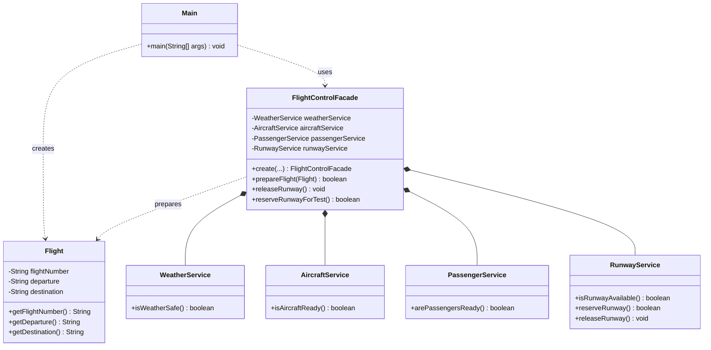

# Airport Flight Control System ✈️

**Assignment #4 — Facade Design Pattern**  
**Course:** Software Design Patterns  


## Overview

Airport Flight Control System is a Java application demonstrating the **Facade** structural design pattern. Preparing a flight involves several independent checks: weather conditions, aircraft readiness, passenger boarding, and runway availability. The `FlightControlFacade` coordinates these services behind a simple interface, so the client does not need to call subsystem classes directly.

> **Disclaimer:** This is an educational simulation, not real aviation control software. The thresholds and readiness rules are simplified for demonstration.

## Design Pattern: Facade

**Pattern category:** Structural

**Intent:** Provide a simplified interface to a complex subsystem.

### Components

| Component | Class | Responsibility |
| --- | --- | --- |
| Client | `Main` | Runs demonstration scenarios using the Facade |
| Facade | `FlightControlFacade` | Creates and coordinates subsystem services |
| Model | `Flight` | Holds flight number, departure, and destination |
| Subsystem | `WeatherService` | Checks whether the configured weather is acceptable |
| Subsystem | `AircraftService` | Checks fuel, engine readiness, and maintenance status |
| Subsystem | `PassengerService` | Checks passenger counts and boarding completion |
| Subsystem | `RunwayService` | Checks, reserves, and releases a runway |

### Architecture



## Project Structure

```text
AirportFlightControlSystem/
├── src/
│   ├── client/
│   │   └── Main.java
│   ├── facade/
│   │   └── FlightControlFacade.java
│   ├── model/
│   │   └── Flight.java
│   └── subsystem/
│       ├── WeatherService.java
│       ├── AircraftService.java
│       ├── PassengerService.java
│       └── RunwayService.java
└── README.md
```

## How It Works

1. The client creates a `Flight` and configures a `FlightControlFacade` through `FlightControlFacade.create(...)`.
2. `prepareFlight(flight)` checks weather conditions.
3. If weather is acceptable, it checks aircraft readiness.
4. If the aircraft is ready, it checks passenger readiness.
5. If all checks pass, it attempts to reserve the runway.
6. The method returns `true` only if all checks and the reservation succeed; otherwise it stops at the first failed check and returns `false`.
7. The client can call `releaseRunway()` after a successful demonstration.

The `Main` class imports `FlightControlFacade` and `Flight`, **not** the four subsystem classes. The subsystem implementations do not depend on the Facade.

## Simplified Usage

```java
Flight flight = new Flight("KC852", "Astana", "Almaty");

FlightControlFacade facade = FlightControlFacade.create(
        "Clear",
        80, true, true,
        180, 180, true,
        "RWY-01"
);

boolean ready = facade.prepareFlight(flight);
if (ready) {
    facade.releaseRunway();
}
```

## Demo Scenarios

The `Main` class runs six demonstration scenarios:

| # | Scenario | Test input | Expected result |
| --- | --- | --- | --- |
| 1 | Successful flight | Clear weather, 80% fuel, all passengers checked in, free runway | `SUCCESS` |
| 2 | Weather failure | `Stormy` | `FAILED` at weather check |
| 3 | Aircraft failure | Fuel level `30` | `FAILED` at aircraft check |
| 4 | Passenger failure | 170 checked in out of 180 | `FAILED` at passenger check |
| 5 | Runway failure | Runway reserved before preparation | `FAILED` at runway reservation |
| 6 | Input validation | Fuel level `-10` | `IllegalArgumentException` caught and reported |

All six scenarios produced their expected results during a console demonstration. These are **manual functional checks**, not automated JUnit tests.

### Example Output (Successful Scenario)

```text
[1] Checking weather...
PASSED: Weather is safe.

[2] Checking aircraft...
PASSED: Aircraft is ready.

[3] Checking passengers...
PASSED: Passengers are ready.

[4] Reserving runway...
PASSED: Runway reserved.
Runway: RWY-01

FLIGHT READY FOR DEPARTURE
FINAL RESULT: SUCCESS
Runway released successfully.
```

## Clean Code Principles

1. **Meaningful Names:** Methods such as `isWeatherSafe()`, `isAircraftReady()`, and `prepareFlight()` clearly communicate their purpose.
2. **Single Responsibility Principle:** Each subsystem handles one area of flight preparation; the Facade coordinates rather than duplicates their logic.
3. **Encapsulation:** State is held in private fields and accessed through appropriate methods.
4. **Input Validation:** Constructors reject invalid inputs, such as a fuel percentage outside `0–100`.
5. **Fail-Fast Error Handling:** The Facade returns immediately when a readiness check fails, avoiding unnecessary subsequent operations.
6. **Avoid Magic Numbers:** `AircraftService` uses a named `MIN_FUEL_LEVEL` constant for the simulation threshold.

## Running the Project

### IntelliJ IDEA

1. Open the `AirportFlightControlSystem` project.
2. Configure a Java SDK compatible with the source code. **JDK 17 is the assignment's specified target.**
3. Open `src/client/Main.java`.
4. Run `Main.main()`.
5. Review the console output for all six scenarios.

### Command Line

From the project root, with a JDK installed:

```bash
javac -d out src/model/*.java src/subsystem/*.java src/facade/*.java src/client/*.java
java -cp out client.Main
```

## Limitations and Future Improvements

- Readiness checks use simulated inputs, not live airport or weather data.
- The public `create(...)` method accepts several configuration parameters; a dedicated configuration object could make the API smaller.
- `reserveRunwayForTest()` is included only to demonstrate an occupied runway and should be replaced with test fixtures in a production-style design.
- Runway reservations are in-memory and not designed for concurrent access.
- Automated unit tests and stronger rollback handling can be added later.

## Assignment Deliverables

- Java source code implementing the Facade pattern
- UML class diagram
- Clean Code explanations with before/after examples in the report
- GitHub repository with incremental commits
- In-class demonstration and defense


